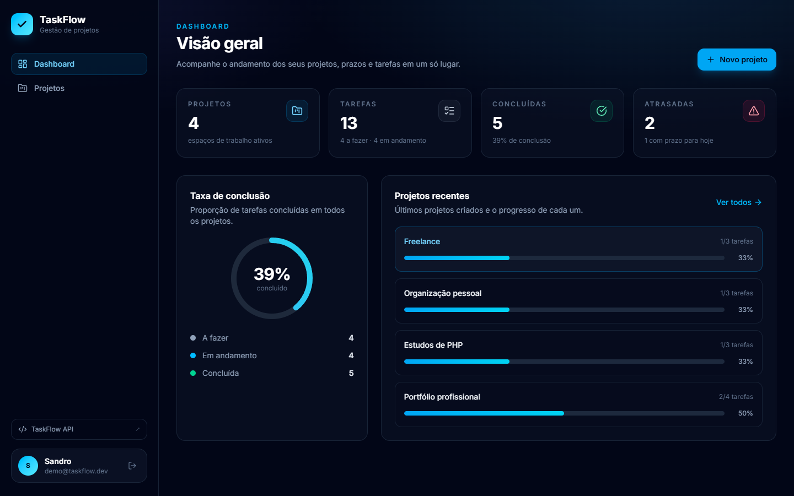
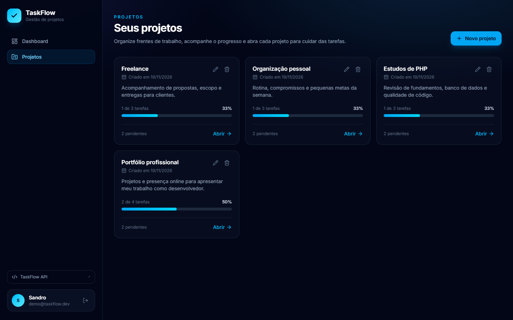
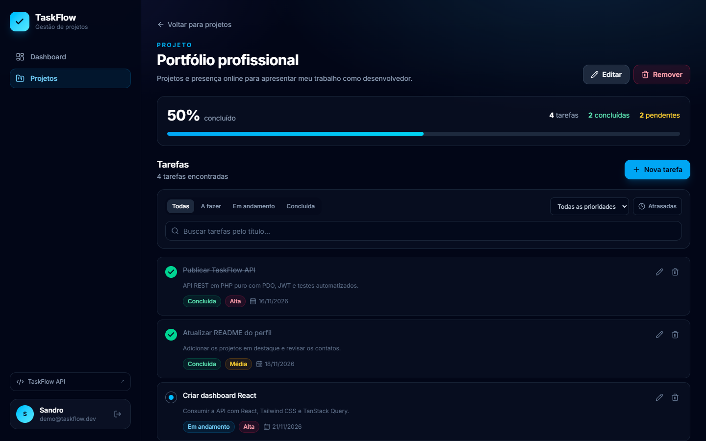
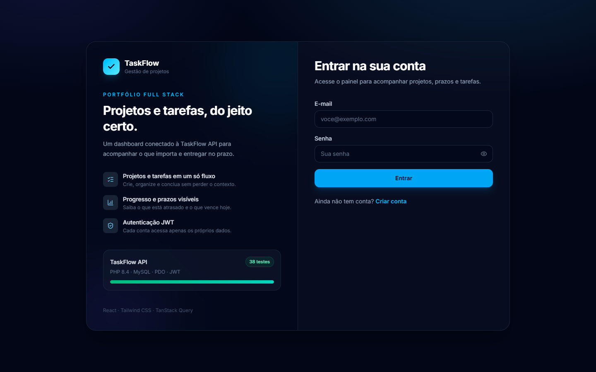
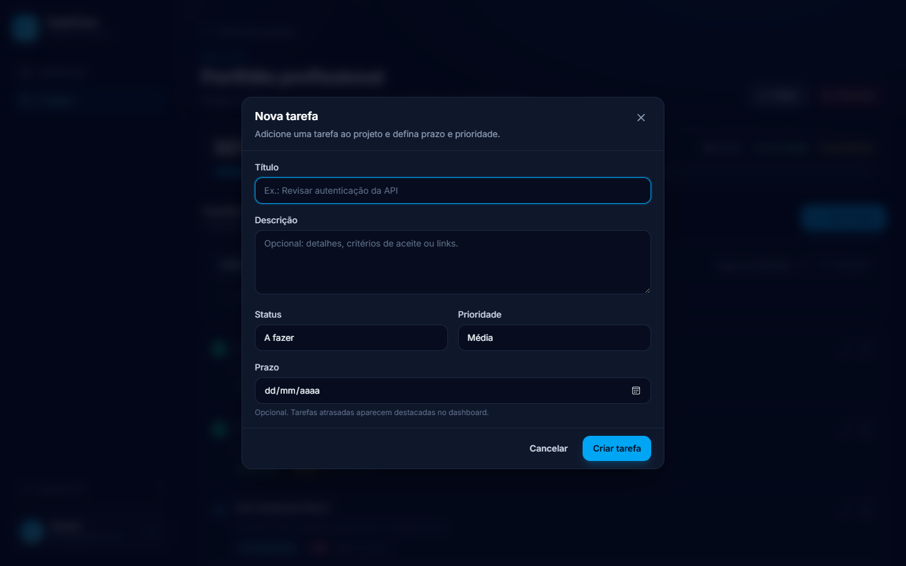
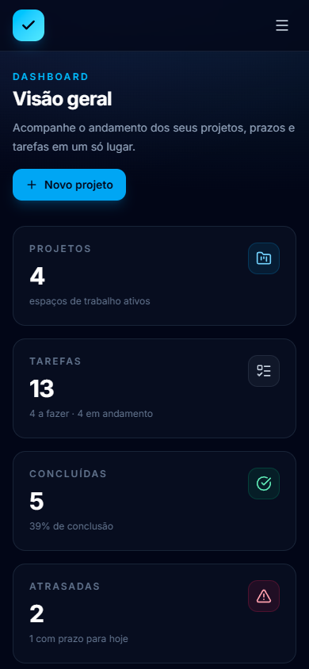

# TaskFlow Dashboard

Dashboard em **React + Tailwind CSS** para gerenciar os projetos e tarefas da [TaskFlow API](https://github.com/Ozzy0s/taskflow-api).

[](https://github.com/Ozzy0s/taskflow-dashboard/actions/workflows/ci.yml)
[](https://react.dev)
[](https://vite.dev)
[](https://tailwindcss.com)
[](LICENSE)

**Português** · [English](#english)



## Sobre o projeto

O TaskFlow Dashboard é a interface web do ecossistema TaskFlow. Ele consome a API REST em PHP e entrega uma experiência completa de autenticação, gestão de projetos e acompanhamento de tarefas — com foco em clareza, prazos e progresso.

O projeto foi construído como peça de portfólio **Full Stack**: a API cuida de autenticação JWT, validação e persistência; o dashboard cuida da experiência, do estado do servidor e da responsividade.

### Funcionalidades

- **Autenticação** — cadastro, login, sessão persistida e logout automático quando o token expira.
- **Dashboard** — contadores de projetos, tarefas, concluídas e atrasadas, taxa de conclusão e projetos recentes.
- **Projetos** — CRUD completo com busca visual, progresso por projeto e paginação.
- **Tarefas** — CRUD completo, alteração rápida de status, filtros por status, prioridade, atrasadas e busca com debounce.
- **Feedback** — toasts de sucesso/erro, estados de carregamento, erros com nova tentativa e confirmação antes de remover.
- **Responsivo** — sidebar fixa no desktop e menu lateral deslizante no mobile.
- **Acessibilidade** — foco visível, navegação por teclado, diálogos com `aria-modal`, botões rotulados e formulários com mensagens associadas.

## Stack

| Camada | Tecnologia |
| --- | --- |
| UI | React 19 + JSX |
| Build | Vite 8 (Rolldown) |
| Estilo | Tailwind CSS 4 |
| Rotas | React Router 7 |
| Dados | TanStack Query 5 |
| Ícones | Lucide React |
| Testes | Vitest + Testing Library + jsdom |
| Lint | Oxlint |
| CI | GitHub Actions (Node 22) |

## Screenshots

| Projetos | Detalhe do projeto |
| --- | --- |
|  |  |

| Login | Nova tarefa |
| --- | --- |
|  |  |

<p align="center">
  
</p>

## Começando

### Pré-requisitos

- Node.js 22+ (mínimo 20.19)
- A [TaskFlow API](https://github.com/Ozzy0s/taskflow-api) em execução (PHP 8.4 + MySQL 8)

### 1. Clone e instale

```bash
git clone https://github.com/Ozzy0s/taskflow-dashboard.git
cd taskflow-dashboard
npm install
```

### 2. Configure a API

Em desenvolvimento, o Vite encaminha `/api` para `http://127.0.0.1:8000`, então basta subir a API na porta 8000. Se ela estiver em outro endereço, crie um `.env`:

```bash
cp .env.example .env
# VITE_API_URL=https://sua-api.exemplo.com
```

### 3. Rode o dashboard

```bash
npm run dev
```

Acesse `http://127.0.0.1:5173`.

### 4. Popule dados de demonstração (opcional)

Com a API rodando e o banco configurado:

```bash
npm run seed
```

O script cria a conta **`demo@taskflow.dev` / `taskflow123`** com 4 projetos e 13 tarefas. Se a conta já tiver projetos, nada é duplicado.

## Scripts

| Comando | Descrição |
| --- | --- |
| `npm run dev` | Servidor de desenvolvimento com proxy para a API |
| `npm run build` | Build de produção em `dist/` |
| `npm run preview` | Pré-visualiza o build localmente |
| `npm run lint` | Analisa o código com Oxlint |
| `npm test` | Executa a suíte de testes uma vez |
| `npm run test:watch` | Testes em modo watch |
| `npm run seed` | Cria a conta e os dados de demonstração |

## Estrutura

```text
src/
├── components/
│   ├── dashboard/      # Cards de métricas e anel de progresso
│   ├── layout/         # App shell, sidebar e layout de autenticação
│   ├── projects/       # Card e formulário de projeto
│   ├── tasks/          # Filtros, linha e formulário de tarefa
│   └── ui/             # Botões, inputs, modal, toasts, paginação...
├── context/            # Sessão e autenticação
├── hooks/              # useDebouncedValue
├── lib/                # Cliente da API, validação, formatação e constantes
├── pages/              # Dashboard, projetos, detalhe, login, cadastro e 404
└── routes/             # Proteção de rotas públicas e privadas
```

## Integração com a API

O cliente em `src/lib/api.js` centraliza as chamadas:

- envia o token JWT em `Authorization: Bearer ...`;
- converte respostas de erro no tipo `ApiError`, com `status`, `code` e `fieldErrors`;
- dispara o evento `taskflow:unauthorized` em respostas `401`, encerrando a sessão;
- monta query strings ignorando valores vazios.

Endpoints consumidos: `/api/auth/login`, `/api/auth/register`, `/api/me`, `/api/projects`, `/api/projects/{id}`, `/api/projects/{id}/tasks`, `/api/tasks/{id}` e `/api/dashboard`.

### Deploy

Gere o build com `npm run build` e publique a pasta `dist/` em qualquer host estático. Defina `VITE_API_URL` no momento do build e configure o host para redirecionar rotas desconhecidas para `index.html` (SPA fallback). A API precisa liberar a origem do dashboard em `CORS_ALLOWED_ORIGIN`.

## Qualidade

- **25 testes** em 6 arquivos cobrindo cliente da API, validação, formatação, modal, tarefa e login.
- **Oxlint** sem avisos.
- **Build de produção** com code splitting do Vite.
- **CI** rodando lint, testes e build em cada push para `main` e pull request.

```bash
npm run lint && npm test && npm run build
```

## Roadmap

- [ ] Deploy público do dashboard e da API
- [ ] Tema claro/escuro
- [ ] Drag and drop para reordenar tarefas
- [ ] Filtros persistentes na URL
- [ ] Notificações de prazos

## English

React + Tailwind dashboard for the [TaskFlow API](https://github.com/Ozzy0s/taskflow-api).

### About

TaskFlow Dashboard is the web interface of the TaskFlow ecosystem. It consumes the PHP REST API and delivers JWT authentication, project CRUD and task tracking with filters, priorities, due dates and progress.

**Highlights**

- Authentication with persisted session and automatic logout on `401`.
- Overview with project/task counters, completion rate and recent projects.
- Full project and task CRUD, quick status toggle and debounced search.
- Filters by status, priority and overdue tasks, plus pagination.
- Loading, empty and error states, toasts and confirmation dialogs.
- Responsive layout with a fixed sidebar on desktop and a drawer on mobile.

### Quick start

```bash
git clone https://github.com/Ozzy0s/taskflow-dashboard.git
cd taskflow-dashboard
npm install
npm run dev
```

The dev server proxies `/api` to `http://127.0.0.1:8000`. For another API address, set `VITE_API_URL` in `.env`. Run `npm run seed` with the API up to create the demo account **`demo@taskflow.dev` / `taskflow123`**.

### Commands

`npm run dev` · `npm run build` · `npm run preview` · `npm run lint` · `npm test` · `npm run seed`

### Deployment

Build with `npm run build`, serve `dist/` with an SPA fallback to `index.html`, and set `VITE_API_URL` at build time. Allow the dashboard origin in the API's `CORS_ALLOWED_ORIGIN`.

## Licença

[MIT](LICENSE) © Sandro (Code.SansJr)
